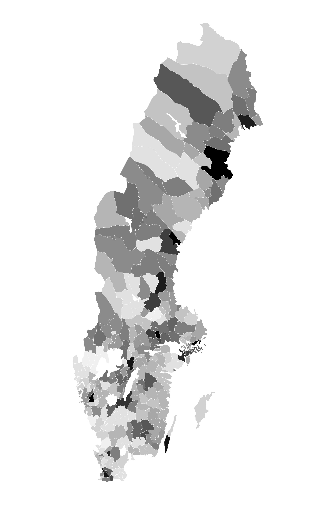
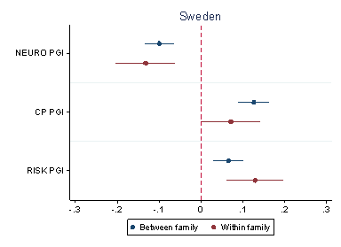
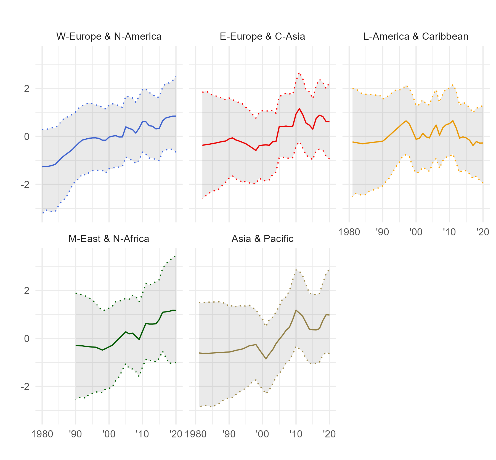
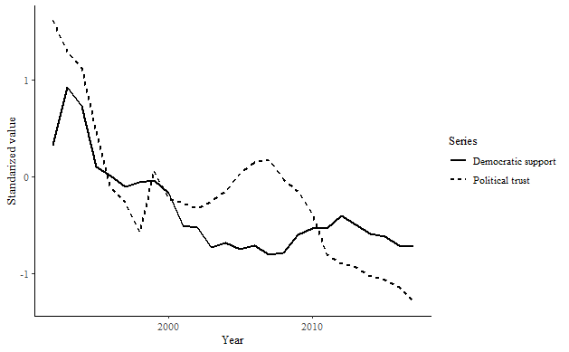
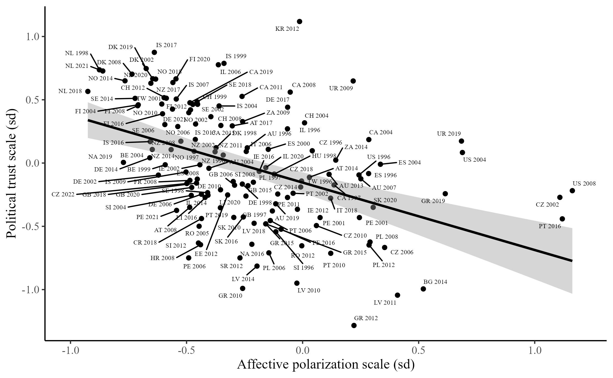
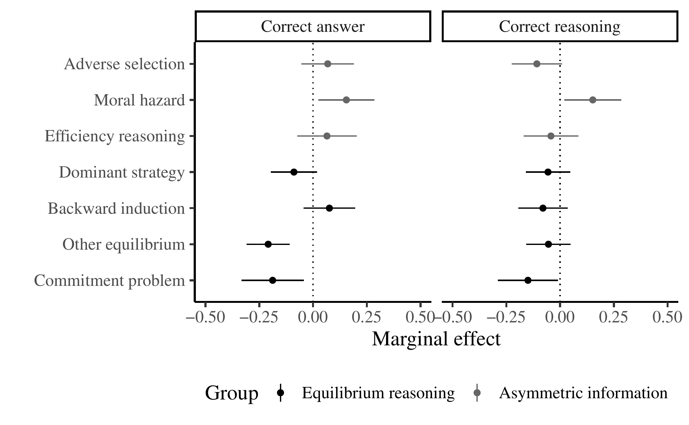
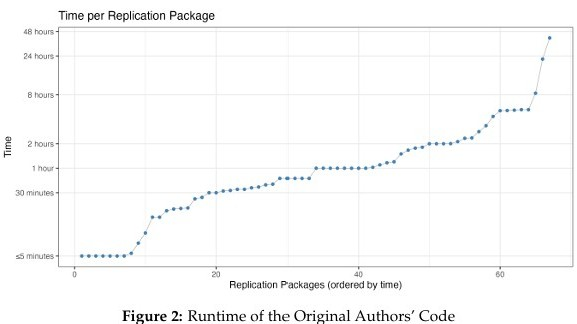

---
title: "Projects"
engine: knitr
page-layout: full
format:
  html:
    mainfont: Georgia
    toc: false
---

::: {style="max-width: 850px; margin: 35px auto; padding: 0 20px;"}

## Attitude formation

::: {.project-entry}
::: {.project-layout}

::: {.project-text}

### Educational reforms and political trust

With Qinya Feng

*APSA 2026*

::: {.publication-toggles}
<a class="toggle-link collapsed" data-bs-toggle="collapse" href="#summary-reforms" role="button" aria-expanded="false" aria-controls="summary-reforms">Summary</a>
<a class="toggle-link collapsed" data-bs-toggle="collapse" href="#abstract-reforms" role="button" aria-expanded="false" aria-controls="abstract-reforms">Abstract</a>
:::

::: {#summary-reforms .collapse .project-collapse}
::: {.project-collapse-content}
Using a staggered compulsory educational reform in Sweden, we show that reforms that reduce ability-based tracking and that bolster civic education can durably increase political trust. 
:::
:::

::: {#abstract-reforms .collapse .project-collapse}
::: {.project-collapse-content}
How do we restore trust in democratic politics? It is often argued that education is crucial to alleviating political distrust, but causal evidence is lacking. We address this challenge by analysing a regionally-staggered educational reform in Sweden that lengthened compulsory schooling, reduced social segregation by removing ability-based tracks, and bolstered civic education. Using a staggered difference-in-difference design, we find strong evidence that the reform boosted political trust, especially among those from less privileged backgrounds. Subsequent analyses using a comparative dataset of compulsory schooling reforms suggest that the operative mechanisms are the removal of ability-based tracking and the increased democratic content of the curriculum. We conclude that well-designed educational reforms can alleviate the crisis of trust facing democracies.
:::
:::

:::

:::

:::

::: {.project-entry}
::: {.project-layout}

::: {.project-text}

### Inherited traits, formative environments, and political trust

With Oskar Pettersson

*Work in progress*

::: {.publication-toggles}
<a class="toggle-link collapsed" data-bs-toggle="collapse" href="#summary-formative" role="button" aria-expanded="false" aria-controls="summary-formative">Summary</a>
<a class="toggle-link collapsed" data-bs-toggle="collapse" href="#abstract-formative" role="button" aria-expanded="false" aria-controls="abstract-formative">Abstract</a>
:::

::: {#summary-formative .collapse .project-collapse}
::: {.project-collapse-content}
Using large-scale family and registry data from the United States and Sweden, we show how random within-family variation in predispositions toward personality traits interacts with formative environments to affect political attitudes. 
:::
:::

::: {#abstract-formative .collapse .project-collapse}
::: {.project-collapse-content}
How are political attitudes formed? It has long been argued that both inherited traits and formative environments are closely related to our political beliefs. However, these relationships are difficult to demonstrate because there are many unmeasured confounders, and because the effects of disposition and early environment are likely to interact with one another. We remedy both issues using large-scale family, genetic, and registry data from the United States and Sweden. We find that random within-family variation in genetic predispositions toward neuroticism, risk tolerance, and cognitive performance are causally related to political trust later in life. Additionally, we show that the effect of cognitive performance is moderated by formative environments. Those with higher cognitive performance are more likely to `rationally' evaluate the trustworthiness of political institutions in relation to their formative environments. We conclude that innate predispositions causally affect political attitudes but that their effects may be moderated by formative environments. 
:::
:::

:::

::: {.project-image}
{.study-image}

:::
:::
:::

## Opinion dynamics

::: {.project-entry}
::: {.project-layout}

::: {.project-text}

### Global trends in social trust

With Marta Kołczyńska and Viktor Valgarðsson

*Under contract with Cambridge University Press, Elements in Comparative Political Behaviour series*

::: {.publication-toggles}
<a class="toggle-link collapsed" data-bs-toggle="collapse" href="#summary-socialtrust" role="button" aria-expanded="false" aria-controls="summary-socialtrust">Summary</a>
<a class="toggle-link collapsed" data-bs-toggle="collapse" href="#abstract-socialtrust" role="button" aria-expanded="false" aria-controls="abstract-socialtrust">Abstract</a>
:::

::: {#summary-socialtrust .collapse .project-collapse}
::: {.project-collapse-content}
This book uses computational measurement models to assess global levels of social trust and study its consequences for society, democracy, and the economy. 
:::
:::

::: {#abstract-socialtrust .collapse .project-collapse}
::: {.project-collapse-content}
Scholarly claims about the importance of social trust for society and democracy are
almost as common as concerns about the negative consequences of low or declining social trust. Nonetheless, systematic conclusions about the state of social trust,
and its potential consequences, are limited by the fragmentation of existing evidence
across countries, time periods, and measurement strategies. In this Element, we apply
Bayesian dynamic latent trait models to comprehensively assess levels and trends in
social trust across the world. We then combine this new evidence with panel causal
inference methods to test the consequences of social trust for a range of key political
and economic outcomes. Contrary to expectations, we find that social trust has generally not declined across new or established democracies, and may even have increased
in the last 40 years. Subsequently, we study the relationships between social trust and
levels of democracy, corruption, economic performance, and inequality. Our results underscore the importance of
social trust for democracy and provide new comparative evidence on the global state of social
trust.
:::
:::

:::

::: {.project-image}
{.study-image}
:::

:::
:::

::: {.project-entry}
::: {.project-layout}

::: {.project-text}

### Political distrust and preferences for regime type

*Revise and resubmit, Journal of Politics*

::: {.publication-toggles}
<a class="toggle-link collapsed" data-bs-toggle="collapse" href="#summary-democracy" role="button" aria-expanded="false" aria-controls="summary-democracy">Summary</a>
<a class="toggle-link collapsed" data-bs-toggle="collapse" href="#abstract-democracy" role="button" aria-expanded="false" aria-controls="abstract-democracy">Abstract</a>
<a href="papers/DemocracyTrust.pdf" target="_blank">PDF</a>
:::

::: {#summary-democracy .collapse .project-collapse}
::: {.project-collapse-content}
Using Bayesian latent variable measures of trust and democratic support, individual-level panel data, and a survey experiment, I show that political trust causally affects support for democratic rule. 
:::
:::

::: {#abstract-democracy .collapse .project-collapse}
::: {.project-collapse-content}
Scholars have long argued that political trust may affect democratic support.
However, this claim has rarely been subject to direct empirical tests. I combine
three sources of evidence to test whether political trust increases support for democracy and decreases support for authoritarian rule. The first is a country-year panel
dataset, created using Bayesian item response models to aggregate available measures
of political trust and support for democracy and authoritarian rule, and covering 83
countries over 27 years (total N = 1,553). I then analyse individual-level panel data
from the United States and Britain. Finally, I conduct a randomized survey experiment in the United States (N = 4,858) in which I manipulate political trust and
test its consequences for support for democracy and authoritarian rule. Across the
designs, political trust consistently increases support for democracy and reduces support for authoritarianism. This suggests that the consequences of political trust for
democracy may be more substantial than previously thought.
:::
:::

:::

::: {.project-image}
{.study-image}
:::

:::
:::

::: {.project-entry}
::: {.project-layout}

::: {.project-text}

### Mass polarization and political distrust

*Under review*

::: {.publication-toggles}
<a class="toggle-link collapsed" data-bs-toggle="collapse" href="#summary-polarization" role="button" aria-expanded="false" aria-controls="summary-polarization">Summary</a>
<a class="toggle-link collapsed" data-bs-toggle="collapse" href="#abstract-polarization" role="button" aria-expanded="false" aria-controls="abstract-polarization">Abstract</a>
<a href="papers/PolarizationTrust.pdf" target="_blank">PDF</a>
:::

::: {#summary-polarization .collapse .project-collapse}
::: {.project-collapse-content}
Using country-year panel data and a survey experiment, I show that aggregate (affective) polarisation causes political distrust. 
:::
:::

::: {#abstract-polarization .collapse .project-collapse}
::: {.project-collapse-content}
It is often argued that polarisation among ordinary partisans could harm
democracies, and one important way in which this could occur is by reducing
trust in democratic political systems. However, existing empirical tests of this
question have produced mixed results. I argue that this is because previous
studies considered the individual-level correlation between attitude extremity
and political distrust. Polarisation - the extent to which people are divided
on ideological and/or affective lines - must instead be measured at the level of
societies. In this article, when measuring polarisation rather than individual-
level attitude extremity, I find that it is likely to undermine trust in democratic
political systems. Using panel data covering 86 democracies over 20 years, I
find that affective polarisation is negatively related to political trust, although
ideological polarisation alone does not appear to be related to political trust. I
then conduct a randomised survey experiment in the UK, which suggests that
these results are likely to be causal in origin. In sum, it appears that affective
polarisation is likely to cause political distrust.
:::
:::

:::

::: {.project-image}
{.study-image}
:::

:::
:::

## Reproducibility and meta-science

::: {.project-entry}
::: {.project-layout}

::: {.project-text}

### Can artificial intelligence solve strategic decision problems?

With Peter Eso, Eszter Kabos and James Tilley

*Revise and resubmit, PLoS One*

::: {.publication-toggles}
<a class="toggle-link collapsed" data-bs-toggle="collapse" href="#summary-strategic" role="button" aria-expanded="false" aria-controls="summary-strategic">Summary</a>
<a class="toggle-link collapsed" data-bs-toggle="collapse" href="#abstract-strategic" role="button" aria-expanded="false" aria-controls="abstract-strategic">Abstract</a>
<a href="papers/StrategicProblems.pdf" target="_blank">PDF</a>
:::

::: {#summary-strategic .collapse .project-collapse}
::: {.project-collapse-content}
Large Language Models solve Oxford undergraduate admissions-style game theory problems at similar rates to human candidates, although their performance drops on tasks requiring complex equilibrium reasoning. 
:::
:::

::: {#abstract-strategic .collapse .project-collapse}
::: {.project-collapse-content}
This paper evaluates the ability of Large Language Models (LLMs) to correctly answer strategic decision problems in the social sciences drawn from a set of previously non-public university
admissions problem sets administered to human candidates from 2008-2024. On average, we find
that LLMs perform similarly to human candidates, but that the type of problem affects solution
rates. LLMs perform better when faced with problems that require numerical calculations of
expected values. They perform worse when given tasks that are not based on well-known ‘text-
book’ problems. They also perform worse on tasks that involve complex equilibrium reasoning
(such as commitment problems) and tasks that require novel insights. These results suggest that
although LLMs perform similarly to human candidates, there remain limitations in their ability
to solve undergraduate-level strategic decision problems.
:::
:::

:::

::: {.project-image}
{.study-image}
:::

:::

:::

::: {.project-entry}
::: {.project-layout}

::: {.project-text}

### Mass reproducibility in psychological science

With Abel Brodeur, Ghina Abdul Baki, Luna Fazio, et al.

*Under review*

::: {.publication-toggles}
<a class="toggle-link collapsed" data-bs-toggle="collapse" href="#summary-psychological" role="button" aria-expanded="false" aria-controls="summary-psychological">Summary</a>
<a class="toggle-link collapsed" data-bs-toggle="collapse" href="#abstract-psychological" role="button" aria-expanded="false" aria-controls="abstract-psychological">Abstract</a>
<a href="https://www.econstor.eu/bitstream/10419/344024/1/I4R-DP326.pdf" target="_blank">PDF</a>
:::

::: {#summary-psychological .collapse .project-collapse}
::: {.project-collapse-content}
A large-scale review of reproducibility in published psychology articles that finds that a substantial minority of articles contain discrepancies with major implications for estimates or interpretation. 
:::
:::

::: {#abstract-psychological .collapse .project-collapse}
::: {.project-collapse-content}
Concerns about the credibility and reproducibility of published findings have motivated numerous initiatives to improve transparency in psychology. In this article, we present evidence from a
large-scale reproducibility initiative conducted in partnership between Psychological Science and
the Institute for Replication (I4R). Our project systematically reproduces empirical results published in the journal between 2024 and 2025 using independent research teams. Through a combination of Replication Games and researcher-led initiatives, 67 independent teams examined
44% of the articles (i.e., 64 articles) published during our time frame, documenting data and
code availability, checking for coding errors, and deviations from preregistration, and computationally reproducing the main numerical results. We find that the majority of articles provide
cleaned data and analysis scripts, though raw data and data-cleaning scripts are shared far less
often. Computational reproducibility depends strongly on the starting point: 58.2% of articles
are fully reproducible from final analysis data, but only 28.4% are fully reproducible from raw
data. Teams identify coding errors or statistical reporting inconsistencies in 63% of articles, although most issues are minor; 40.5% of the articles flagged with coding or statistical reporting
issues contain discrepancies with potentially major implications for estimates or interpretation.
Preregistration is common (74.6% of articles), yet 84% of preregistered articles deviate from their
pre-analysis plan, and nearly half of these deviations go unacknowledged. Our findings provide
new insights into the reliability of empirical results in a leading psychology journal and highlight
the value of structured mass reproducibility initiatives.
:::
:::

:::

::: {.project-image}
{.study-image}

:::
