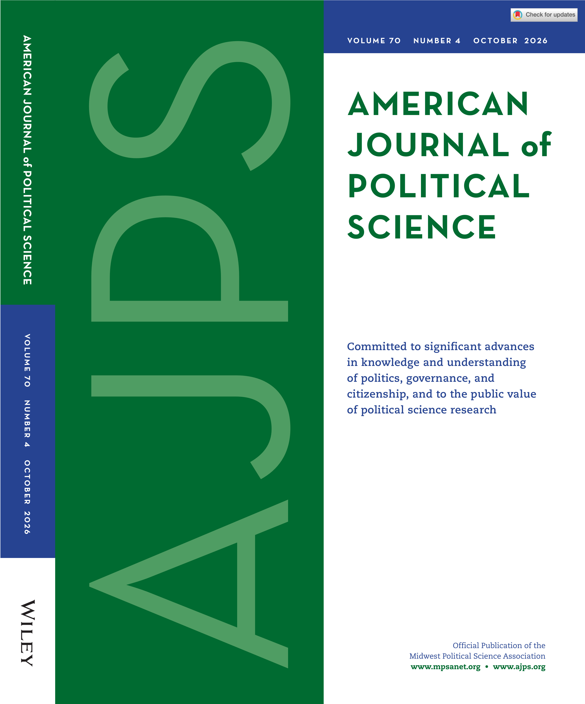
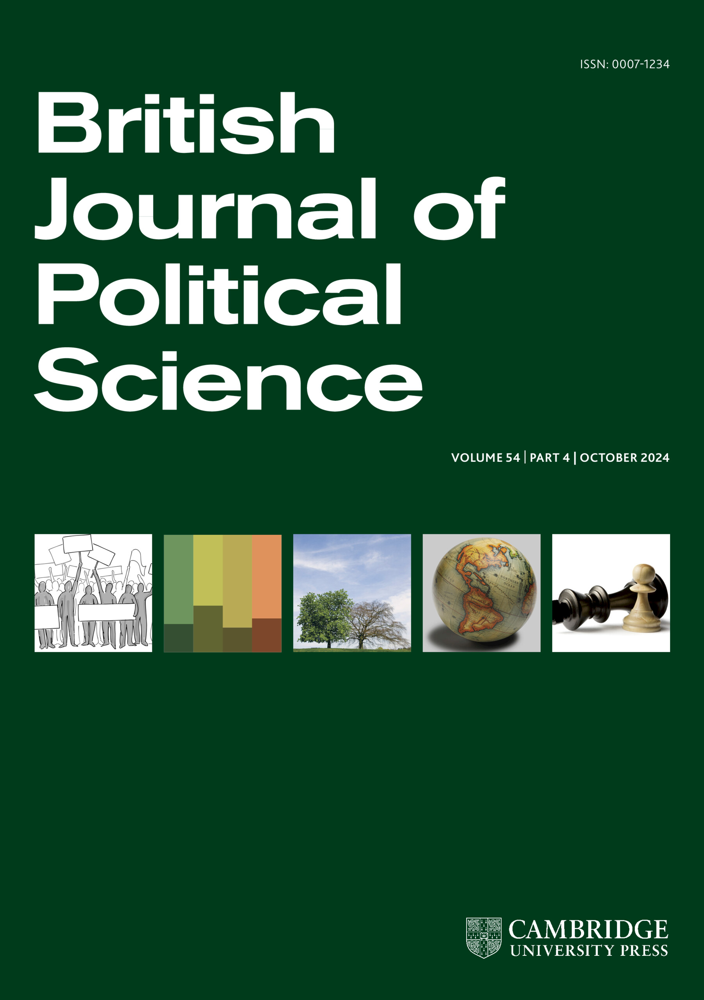
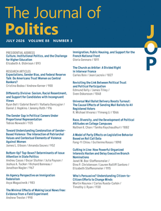
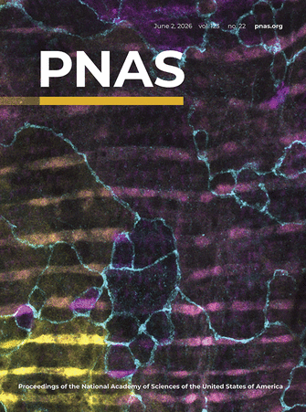

---
title: "Publications"
engine: knitr
page-layout: full
format:
  html:
    mainfont: Georgia
    toc: false
---

::: {style="max-width: 850px; margin: 35px auto; padding: 0 20px;"}

## Attitude formation

::: {.publication-entry}
::: {.publication-layout}

::: {.publication-text}

### [Educational attainment and political trust](papers/EducTrust.pdf)

With Qinya Feng

*American Journal of Political Science*, forthcoming.

::: {.publication-toggles}
<a class="toggle-link collapsed" data-bs-toggle="collapse" href="#summary1" role="button" aria-expanded="false" aria-controls="summary1">Summary </a>
<a class="toggle-link collapsed" data-bs-toggle="collapse" href="#abstract1" role="button" aria-expanded="false" aria-controls="abstract1">Abstract </a>
:::

::: {#summary1 .collapse .publication-collapse}
::: {.publication-collapse-content}
The positive association between educational attainment and political trust is largely explained by shared family background rather than by a causal effect of educational attainment on political trust.
:::
:::

::: {#abstract1 .collapse .publication-collapse}
::: {.publication-collapse-content}
Education is crucial for many political attitudes and behaviors, but its relationship with political trust is less clear. We show with a meta-analysis that educational attainment is positively associated with political trust. We then argue that these associations are substantially explained by the common family background of those who are more trusting and who select into further education. Using data from four twin studies, we show that the relationship between educational attainment and political trust is attenuated when accounting for factors shared by twins. We then demonstrate that the relationship is reduced when matching respondents on their early life conditions, but not when adjusting for a genetically informed measure of predispositions toward education. In sum, those predisposed to political trust are also predisposed to remain in education, and so educational attainment is less likely to causally explain political trust.
:::
:::

::: {.publication-links}
[PDF](papers/EducTrust.pdf)
:::

:::

::: {.publication-image}
{.journal-cover}
:::

:::
:::

::: {.publication-entry}
::: {.publication-layout}

::: {.publication-text}

### [Personality traits and political trust](papers/PersonalityTrust.pdf)

*British Journal of Political Science*, forthcoming.

::: {.publication-toggles}
<a class="toggle-link collapsed" data-bs-toggle="collapse" href="#summary2" role="button" aria-expanded="false" aria-controls="summary2">Summary </a>
<a class="toggle-link collapsed" data-bs-toggle="collapse" href="#abstract2" role="button" aria-expanded="false" aria-controls="abstract2">Abstract </a>
:::

::: {#summary2 .collapse .publication-collapse}
::: {.publication-collapse-content}
Personality traits and political trust are closely connected dispositions informed by similar early-life characteristics and experiences, suggesting that trust may be formed relatively early in life. 
:::
:::

::: {#abstract2 .collapse .publication-collapse}
::: {.publication-collapse-content}
Many political attitudes tend to be stable in adulthood, and one explanation for this is that underlying personality traits cause people to develop different political views. However, an alternative view is that both personality traits and political attitudes reflect shared underlying formative experiences and inherited predispositions. Using twin and family data, I seek to explain why those who are higher in agreeableness and lower in neuroticism tend to be more politically trusting. Using co-twin and co-sibling models, I find that the associations between agreeableness, neuroticism, and political trust are substantially explained by family background. Subsequent tests using variance decomposition models suggest that both genes and environment play a role. I conclude that the associations between personality traits and political trust are explained by common underlying factors that cause them to develop jointly. This suggests that political attitudes may be formed earlier than some accounts assume.
:::
:::

::: {.publication-links}
[PDF](papers/PersonalityTrust.pdf)
:::

:::

::: {.publication-image}
{.journal-cover}
:::

:::
:::

::: {.publication-entry}
::: {.publication-layout}

::: {.publication-text}

### [Revisiting the link between political trust and political participation](https://www.journals.uchicago.edu/doi/10.1086/736338)

With James Tilley and Sven Oskarsson

*Journal of Politics*, 88(3), 1048–1065 (2026).

::: {.publication-toggles}
<a class="toggle-link collapsed" data-bs-toggle="collapse" href="#summary3" role="button" aria-expanded="false" aria-controls="summary3">Summary </a>
<a class="toggle-link collapsed" data-bs-toggle="collapse" href="#abstract3" role="button" aria-expanded="false" aria-controls="abstract3">Abstract </a>
:::

::: {#summary3 .collapse .publication-collapse}
::: {.publication-collapse-content}
Using data from three twin studies, we show that political trust is moderately heritable and that previous estimates of the association between trust and participation are overstated. 
:::
:::

::: {#abstract3 .collapse .publication-collapse}
::: {.publication-collapse-content}
Political trust is typically seen as a cause of political participation, and thus, declining levels of trust in politicians and institutions are often blamed for political disengagement. By revisiting the formation of political trust, we argue that this blame may be misplaced. We show that the correlation between political trust and participation is largely explained by heritable predispositions that make some people simultaneously more likely to trust political authorities and to participate in politics. Using variance decomposition models and co-twin control designs with data from three twin studies from the United States, Sweden, and Australia, we demonstrate that trust is moderately heritable and that previous estimates of the association between trust and participation are overstated. This result is robust to multiple operationalizations and specifications. We conclude that political trust may be less likely to affect political behavior than previously thought.
:::
:::

::: {.publication-links}
[PDF](papers/TrustParticipation.pdf) ·
[DOI](https://www.journals.uchicago.edu/doi/10.1086/736338)
:::

:::

::: {.publication-image}
{.journal-cover}
:::

:::
:::

::: {.publication-entry}
::: {.publication-layout}

::: {.publication-text}

### [Misconduct by voters' own representatives does not affect voters' generalized political trust](https://www.cambridge.org/core/journals/british-journal-of-political-science/article/misconduct-by-voters-own-representatives-does-not-affect-voters-generalized-political-trust/DE5F4F1F042DF959F6E212E22F9874BE)

With James Tilley

*British Journal of Political Science*, 54(4), 1496–1505 (2024).

::: {.publication-toggles}
<a class="toggle-link collapsed" data-bs-toggle="collapse" href="#summary4" role="button" aria-expanded="false" aria-controls="summary4">Summary </a>
<a class="toggle-link collapsed" data-bs-toggle="collapse" href="#abstract4" role="button" aria-expanded="false" aria-controls="abstract4">Abstract </a>
:::

::: {#summary4 .collapse .publication-collapse}
::: {.publication-collapse-content}
Even when voters know their own MP was implicated in a political scandal, this does not appear to reduce their broader trust in politicians and political institutions.
:::
:::

::: {#abstract4 .collapse .publication-collapse}
::: {.publication-collapse-content}
One reason given for declining levels of trust in politicians and institutions is the incidence of scandals involving voters' representatives. Politicians implicated in scandals, especially financial scandals, typically see their constituents' support for them decrease. It has been suggested that these specific negative judgements about a representative's misconduct spill over onto diffuse political trust in the system as a whole. We argue that the 2009 Parliamentary expenses scandal in the United Kingdom is a strong test of these scandal spillover effects in a non-experimental context. Yet, using a multilevel analysis of survey and representative implication data, we find no evidence for these effects. This is despite voters being aware of their MP's scandal implication, and this awareness affecting voters' support for their own MP. We conclude that voters' judgements about their constituency representatives are unlikely to affect their diffuse political trust.
:::
:::

::: {.publication-links}
[PDF](papers/MisconductTrust.pdf) ·
[DOI](https://www.cambridge.org/core/journals/british-journal-of-political-science/article/misconduct-by-voters-own-representatives-does-not-affect-voters-generalized-political-trust/DE5F4F1F042DF959F6E212E22F9874BE)
:::

:::

::: {.publication-image}
{.journal-cover}
:::

:::
:::

## Reproducibility and meta-science

::: {.publication-entry}
::: {.publication-layout}

::: {.publication-text}

### [Comparing human-only, AI-assisted, and AI-led teams on assessing research reproducibility in quantitative social science](https://www.pnas.org/doi/full/10.1073/pnas.2524747123)

With Abel Brodeur, David Valenta, Alexandru Marcoci, et al.

*Proceedings of the National Academy of Sciences*, 123(22), e2524747123 (2026).

::: {.publication-toggles}
<a class="toggle-link collapsed" data-bs-toggle="collapse" href="#summary5" role="button" aria-expanded="false" aria-controls="summary5">Summary </a>
<a class="toggle-link collapsed" data-bs-toggle="collapse" href="#abstract5" role="button" aria-expanded="false" aria-controls="abstract5">Abstract </a>
:::

::: {#summary5 .collapse .publication-collapse}
::: {.publication-collapse-content}
Human researchers, whether working with or without AI assistance, are substantially more effective at reproducing published research and identifying serious errors than AI-led teams.
:::
:::

::: {#abstract5 .collapse .publication-collapse}
::: {.publication-collapse-content}
Large Language Models (LLMs) such as ChatGPT are transforming how scientists conduct and validate research, offering promise as tools to improve scientific reproducibility. However, computational reproducibility and error detection remain expensive and labor-intensive. We experimentally test how collaboration between researchers and LLM assistants influences the reproduction of quantitative social science findings across different levels of AI autonomy. We randomly assigned 288 researchers to 103 teams working under three conditions: human-only, AI-assisted (using ChatGPT as a collaborative tool), or AI-led (ChatGPT operating with minimal human oversight). Teams reproduced published results from leading social science journals, detected coding errors, and proposed robustness checks. Human-only and AI-assisted teams achieved comparable reproduction rates (94% vs. 91%) and performed similarly on most outcomes, except human-only teams identified significantly more major coding errors. Both substantially outperformed AI-led teams, which achieved only a 37% reproduction rate, detected fewer errors across all categories, proposed weaker robustness checks, and required more time. This autonomous approach, however, likely represents only a lower bound of AI capabilities. Despite rapid model advances, expert human judgment currently remains indispensable for reliable empirical verification. While AI assistance did not degrade most outcomes, it provided no measurable advantages and was associated with reduced detection of major errors. However, the 37% autonomous reproduction rate indicates that AI could provide value in settings where scale or cost constraints preclude human review of papers, even though general-purpose LLMs offer no immediate advantages for human-supervised verification.
:::
:::

::: {.publication-links}
[PDF](https://www.econstor.eu/bitstream/10419/308508/1/I4R-DP195.pdf) ·
[DOI](https://www.pnas.org/doi/full/10.1073/pnas.2524747123)
:::

:::

::: {.publication-image}
{.journal-cover}
:::

:::
:::

::: {.publication-entry}
::: {.publication-layout}

::: {.publication-text}

### [Reproducibility and robustness of economics and political science research](https://www.nature.com/articles/s41586-026-10251-x)

With Abel Brodeur, Derek Mikola, Nikolai Cook, et al.

*Nature*, 652(8108), 151–156 (2026).

::: {.publication-toggles}
<a class="toggle-link collapsed" data-bs-toggle="collapse" href="#summary6" role="button" aria-expanded="false" aria-controls="summary6">Summary </a>
<a class="toggle-link collapsed" data-bs-toggle="collapse" href="#abstract6" role="button" aria-expanded="false" aria-controls="abstract6">Abstract </a>
:::

::: {#summary6 .collapse .publication-collapse}
::: {.publication-collapse-content}
Most published findings in leading economics and political science journals can be computationally reproduced, although a substantial minority are sensitive to alternative analytical choices.
:::
:::

::: {#abstract6 .collapse .publication-collapse}
::: {.publication-collapse-content}
Science aspires to be cumulative. Reproducibility efforts strengthen science by testing the reliability of published findings, promoting self-correction, and informing policy-making1. Computational reproductions, whereby independent researchers reproduce the results of published studies, are an essential diagnostic tool. Such efforts should have greater visibility. However, little social science reproduction and robustness has been conducted at scale. Here we reproduced original analyses and conducted robustness checks of 110 articles that were published in leading economics and political science journals with mandatory data and code sharing policies. We found that more than 85% of published claims were computationally reproducible. In robustness checks, our reanalyses showed that 72% of statistically significant estimates remain significant and in the same direction, and the median reproduced effect size is nearly the same as the originally published effect size (that is, 99% of the published effect size). Additionally, 6 independent research teams examined 12 pre-specified hypotheses about determinants of robustness. Research teams with more experience found lower levels of robustness, and robustness did not correlate with author characteristics or data availability.
:::
:::

::: {.publication-links}
[PDF](papers/NatureReproducibility.pdf) ·
[DOI](https://www.nature.com/articles/s41586-026-10251-x)
:::

:::

::: {.publication-image}
{.journal-cover}
:::

:::
:::

:::
